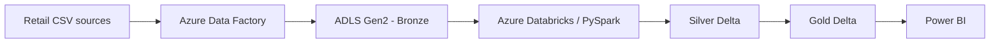

# Retail Sales Analytics Pipeline

An end-to-end retail analytics project demonstrating incremental ingestion, a Bronze-Silver-Gold lakehouse pattern, PySpark transformations, data quality checks, and business-facing SQL analysis.

> **Project status:** This repository is a practical implementation and learning portfolio. Update the status and screenshots as each component is executed in your own Azure environment. The design documents are not proof of a deployed cloud environment.

## Architecture

## Data domains
Product, Region, Reseller, Sales, Salesperson, Salesperson Region, and Target.

## Repository guide
- `adf/`: incremental ingestion and watermark design
- `notebooks/`: PySpark Bronze, Silver, and Gold processing examples
- `sql/`: validation and business analysis queries
- `tests/`: reusable data-quality checks
- `powerbi/`: dashboard wireframe and KPI definitions
- `architecture/`: architecture notes
- `data/`: expected source-file layout (source data is not committed)

## Run locally
1. Install Python 3.10+ and Java compatible with your PySpark version.
2. Create a virtual environment and install dependencies: `pip install -r requirements.txt`.
3. Place the seven source CSVs under `data/raw/` (see `data/README.md`).
4. Open the notebooks in a Spark environment and update the input/output paths for your environment.
5. Run Bronze, then Silver, then Gold.

The notebooks use local paths as a starter. For Azure deployment, configure ADLS Gen2 access using a managed identity / Databricks Access Connector and Unity Catalog external locations rather than embedding credentials.

## Key engineering concepts
- Incremental ingestion with a persisted watermark
- Idempotent processing and retry considerations
- Delta Lake Bronze / Silver / Gold layers
- Schema and data-quality validation
- Window functions for top-N analysis
- Sales-versus-target reporting

## Important
No customer or company confidential data is included. Add only datasets you are permitted to share. Do not commit secrets, access keys, tokens, or raw personal data.
