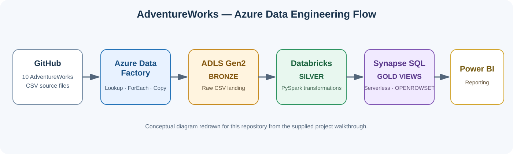

# Retail Sales Analytics Pipeline

A portfolio reconstruction based on the AdventureWorks retail dataset and the Azure medallion pipeline described in the supplied project document.

> **Status:** Repository starter implementation. The source document describes an Azure Data Factory → ADLS Gen2 → Databricks → Synapse Serverless SQL flow. This repository contains code and configuration examples; it does not claim that an Azure environment has been deployed or executed.

## Architecture

Source: AdventureWorks CSV files hosted in [the dataset repository](https://github.com/anshlambaoldgit/Adventure-Works-Data-Engineering-Project/tree/main/Data). See [source manifest](data/source-manifest.json).

## Pipeline flow
1. ADF HTTP linked service reads source files from GitHub.
2. ADF Lookup reads a JSON parameter file; ForEach passes each file URL and sink path to a parameterized Copy Activity.
3. ADLS Gen2 stores the raw files in Bronze.
4. Databricks / PySpark transforms Calendar, Customers, Products, and Sales data into Silver.
5. Synapse Serverless SQL uses OPENROWSET over Silver Parquet files and exposes Gold-layer views.
6. Power BI can consume the curated views.

## Repository guide
- `adf/`: parameterized ingestion design, configuration, and watermark example (watermark is an optional enhancement, not shown in the supplied document)
- `notebooks/`: PySpark Bronze and Silver examples
- `synapse/`: Gold-layer Serverless SQL view templates
- `sql/`: data validation and business analysis queries
- `tests/`: reusable data-quality checks
- `powerbi/`: dashboard wireframe and KPI definitions
- `architecture/`: architecture notes and diagram
- `data/`: source manifest and dataset instructions

## Dataset and execution notes
- The ten source filenames are listed in `data/source-manifest.json`; the upstream repository is linked there.
- Download them with `bash scripts/download_adventureworks.sh` and run the source contract tests before Spark processing.
- Bronze now preserves source values as strings and overwrites each table snapshot on rerun. This avoids duplicate accumulation from blind append.
- Silver uses the documented source transformations. Gold sales amount is explicitly an estimate (`ProductPrice * OrderQuantity`), because the provided sales files do not contain a transaction sales-amount field. Do not call it actual revenue.
- The watermark SQL is an optional pattern only; the current source is static CSV and no reliable modified timestamp is documented.

## Run locally
1. Install Python 3.10+ and a compatible Java runtime.
2. Install dependencies: `pip install -r requirements.txt`.
3. Download the permitted AdventureWorks CSV files into `data/raw/` (see `data/README.md`).
4. Run the notebooks in a Spark environment after checking the source column names and updating paths.
5. Run source contract checks after downloading the CSVs: `python -m unittest discover -s tests -p "test_*.py" -v`.
6. For Azure deployment, configure ADF, ADLS Gen2, Databricks, and Synapse using your own subscription and secure identity configuration.

## Scope and honesty
The supplied document demonstrates parameterized full-file ingestion, PySpark transformations, and Synapse Serverless SQL views. It does **not** document a watermark-based incremental load, a full dimensional star-schema build, Unity Catalog, or a Power BI dashboard implementation. Those are possible extensions, not source-documented completed steps.

Do not commit secrets, access keys, tokens, or private/customer data.
